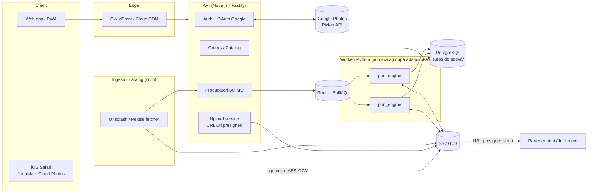
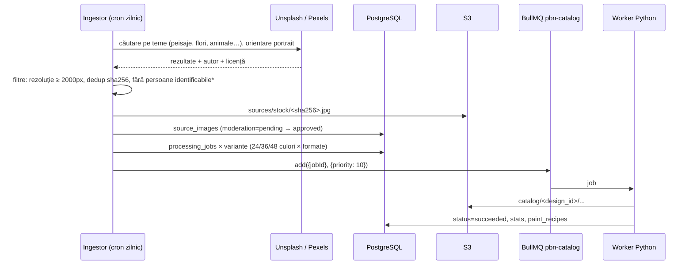
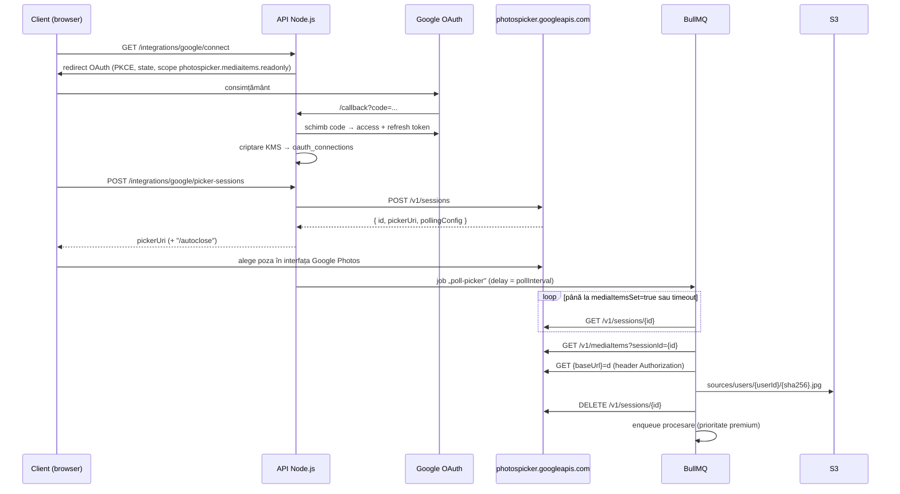

# Platforma POD „Paint by Numbers" — Arhitectura generală

> Livrat: arhitectura, motorul Python (`processing/pbn_engine`), worker-ul de coadă Python (`processing/pbn_worker`),
> API-ul Node.js (`api/`: OAuth Google Photos Picker, upload criptat iCloud/Web Crypto, cozi BullMQ, ingestorul de catalog),
> schema PostgreSQL (`db/schema.sql`) și CI (`.github/workflows/pbn-platform.yml`).

---

## 1. Vedere de ansamblu



| Componentă | Tehnologie | Rol |
|---|---|---|
| API | Node.js 22, Fastify, `pg`, `bullmq`, `@aws-sdk/client-s3` | Auth, OAuth, comenzi, catalog, enqueue |
| Worker | Python 3.11+, `pbn_engine` (OpenCV, scikit-learn, scikit-image) | Procesare imagine — CPU-bound |
| Coadă | Redis 7 + BullMQ (alternativ AWS SQS + DLQ) | Livrare job-uri, retry, prioritate, rate-limit |
| Bază de date | PostgreSQL 16 | Starea job-urilor, comenzi, catalog, rețete |
| Stocare | S3 (sau GCS) + CDN | Surse, fișiere de producție, mockup-uri |
| Criptare | AWS KMS / GCP KMS | Token-uri OAuth, chei de upload Web Crypto |

**Principiul central:** PostgreSQL este sursa de adevăr pentru starea fiecărui job; coada doar *livrează* ID-uri de job.
Mesajul din coadă conține doar `{ jobId }`, iar workerul citește parametrii din DB. Dacă Redis se pierde, job-urile
`queued`/`running` sunt re-enqueue-ate din tabelă (vezi interogările de la finalul `db/schema.sql`).

---

## 2. Motorul de procesare (`processing/pbn_engine`)

Pipeline determinist (același input + aceiași parametri + aceeași versiune = același output):

| Etapă | Modul | Ce face |
|---|---|---|
| 1. Normalizare | `quantize.py` | Orientare EXIF, transparență → alb, crop/pad la raportul pânzei, rezoluție de lucru derivată din mm (implicit 4 px/mm) |
| 2. Netezire | `quantize.py` | Filtru bilateral ×2 — elimină texturi fine, păstrează marginile |
| 3. K-Means | `quantize.py` | Clustering în **CIELAB** (distanță ≈ diferență percepută), antrenat pe 80k pixeli eșantionați; paleta sortată deschis → închis |
| 4. Curățare | `regions.py` | Filtru de majoritate + absorbția regiunilor < `min_region_mm2` sau mai înguste decât `min_clearance_mm` |
| 5. Etichete | `regions.py` | Centroid dacă e în interior și are spațiu; altfel **pol de inaccesibilitate** (maximul transformatei distanță) — corect și pentru forme concave |
| 6. Vectorizare | `vectorize.py` | Marching squares la iso-nivelul 0.5 → frontiere *comune* între regiuni (o singură linie, nu două decalate); SVG la dimensiune fizică în mm + PDF prin CairoSVG |
| 7. Contururi raster | `vectorize.py` | Canny pe harta de etichete (+ salturi exacte) pentru previzualizări PNG |
| 8. Rețetă | `paint.py` | Arie px → cm² → ml; HEX/RGB/LAB/CMYK; recipient recomandat |
| 9. Previzualizări | `mockup.py` | `painted.png`, `numbered.png`, `palette.png`, `mockup.jpg` (perete, șasiu 3D, umbră — procedural) |

### Modelul de consum de vopsea

```
aria_cm²  = pixeli_culoare × (aria_pânzei_cm² / pixeli_totali)
volum_ml  = aria_cm² × (grosime_film_mm / 10) × straturi × (1 + pierderi)
```

Implicit: film umed 0.08 mm, 2 straturi (+1 pentru culori cu L* ≥ 78, care acoperă mai slab), 20% pierderi, minim 1.5 ml.
Pentru 40×50 cm → ~40–55 ml total. **Calibrare:** după primele loturi, cântăriți recipientele rămase și ajustați `wet_film_mm`.

### CMYK
Conversia implicită este matematică (fără profil) și e doar orientativă. Pentru tipar, transmiteți `--icc ISOcoated_v2.icc`
(FOGRA39) sau profilul furnizat de tipografie; conversia se face prin LittleCMS (Pillow `ImageCms`, intent perceptual).

### Performanță măsurată
Imagine 512×512 → pânză 40×50 cm la 4 px/mm (1600×2000 px), 24 culori: **~10 s / job pe 1 core**, ~880 regiuni.
Cel mai scump pas e exportul PDF (Cairo). Un worker cu 1 vCPU ≈ 300–360 job-uri/oră.

### Fișiere produse per job

| Fișier | Destinație |
|---|---|
| `canvas.svg` / `canvas.pdf` | **Producție** — print pe pânză (contururi + numere, dimensiune fizică în mm) |
| `solution.svg` | Control calitate / previzualizare colorată vectorială |
| `recipe.json` | Rețeta de vopsele (număr, HEX, RGB, LAB, CMYK, cm², ml, recipient) → producția de kituri |
| `manifest.json` | Versiune motor, hash sursă, timpi, dificultate, configurația completă |
| `mockup.jpg`, `painted.png`, `numbered.png`, `palette.png` | Magazin / email de aprobare |

---

## 3. Modulul 1 — Generatorul automat de catalog



- **Variante:** fiecare imagine aprobată → N job-uri (ex. 24/36/48 culori × 30×40 / 40×50 cm). Cheia `UNIQUE(source_image_id, num_colors, canvas_w_mm, canvas_h_mm)` previne duplicatele.
- **Limite API:** Unsplash și Pexels aplică limite orare/lunare de request-uri; ingestorul folosește un rate-limiter BullMQ dedicat și cache al rezultatelor de căutare.
- **Respectarea termenilor (de verificat juridic înainte de lansare):**
  - Licențele Unsplash și Pexels permit uz comercial, dar **interzic vânzarea fotografiilor nemodificate** și (Unsplash) compilarea pozelor pentru a replica un serviciu similar/concurent. Produsul nostru e o lucrare transformată, dar păstrați atribuirea autorului (`author_name`, `attribution_url`) și declanșați endpoint-ul de „download tracking" cerut de ghidurile API Unsplash.
  - *Portretele cu persoane identificabile, mărcile și operele de artă din fotografii nu sunt acoperite de un „model release". Recomandare: excludeți-le automat din catalog (`has_people`) sau trimiteți-le la moderare manuală.
- **Moderare:** primele loturi trec printr-o coadă de aprobare umană (`moderation`); ulterior se poate adăuga un clasificator automat.

---

## 4. Modulul 2 — Pachetul Premium: Google Photos & iCloud

### 4.1 Google Photos — **Picker API** (nu Library API)

> ⚠️ Din 31 martie 2025, Google a restrâns Photos **Library** API: aplicațiile pot citi doar elementele create de ele însele;
> scope-ul `photoslibrary.readonly` pentru întreaga bibliotecă nu mai este disponibil aplicațiilor noi.
> Pentru „utilizatorul își alege o poză din galeria lui", soluția oficială este **Google Photos Picker API**.



Observații:
- Picker API nu trimite webhook-uri: „tragerea" automată se face prin **polling server-side** într-un job BullMQ, respectând `pollingConfig` primit — utilizatorul nu așteaptă cu pagina deschisă.
- `baseUrl` expiră (~60 min) → descărcarea se face imediat în job, apoi fișierul trăiește doar în bucket-ul nostru.
- Se descarcă originalul (`=d`); HEIC se convertește în worker (Pillow + `pillow-heif`).
- Refresh token-ul este criptat cu envelope encryption (KMS) și poate fi revocat de utilizator (`revoked_at`).

### 4.2 Apple iCloud Photos

> ⚠️ Apple **nu oferă un API web public** pentru biblioteca iCloud Photos a unui utilizator. CloudKit JS accesează doar
> containerele CloudKit ale aplicației noastre, nu Photos. Arhitectura corectă este deci „client push", nu „server pull".

**Varianta A (lansare — web, fără aplicație nativă):**
1. Pe iPhone/iPad/Mac, `<input type="file" accept="image/*">` deschide selectorul nativ Photos, care include automat
   biblioteca **iCloud Photos** (iOS descarcă originalul din iCloud la nevoie).
2. În browser, cu **Web Crypto API**:
   - se calculează `SHA-256` al fișierului (integritate + dedup);
   - se generează o cheie `AES-256-GCM` efemeră și se criptează fișierul;
   - cheia AES este „împachetată" cu cheia publică `RSA-OAEP-3072` a serviciului (cheie asimetrică KMS; privata nu părăsește KMS).
3. API-ul emite un URL **presigned S3** (PUT sau multipart pentru > 100 MB), valabil 5 minute, restricționat la `Content-Length` și `Content-Type`.
4. Browserul urcă **direct în S3** ciphertext-ul (API-ul nu proxy-ază fișiere mari), apoi trimite `{uploadId, wrappedKey, iv, sha256}`.
5. Workerul de ingestie: `KMS Decrypt(wrappedKey)` → decriptare AES-GCM → verificare SHA-256 → mutare în `sources/users/...` → enqueue procesare.

Criptarea aplicativă se adaugă peste TLS + SSE-KMS: protejează împotriva unui URL presigned scurs, a unui bucket configurat
greșit sau a logării accidentale a conținutului.

**Varianta B (fază ulterioară — aplicație iOS):** `PHPickerViewController` (nu cere acces la toată biblioteca) → același flux
de upload presigned. CloudKit devine util doar dacă vrem sincronizare între dispozitivele utilizatorului în containerul aplicației noastre.

---

## 5. Coada de procesare

| Coadă BullMQ | Producător | Prioritate | Concurență / limită |
|---|---|---|---|
| `pbn-orders` | API (comenzi premium + standard) | 1 (premium) – 5 | workeri dedicați, fără rate-limit |
| `pbn-catalog` | Ingestor | 10 | rate-limit, rulează pe instanțe Spot |
| `pbn-ingest` | API (Google poll, decriptare iCloud) | 3 | I/O-bound, concurență mare |

- **Retry:** 3 încercări, backoff exponențial (10 s, 40 s, 160 s); apoi `status='dead'` + alertă (echivalentul DLQ).
- **Idempotență:** `idempotency_key = sha256(source) + sha256(params) + engine_version` — un retry sau un dublu-click nu reprocesează.
- **Heartbeat:** workerul actualizează `heartbeat_at`; un reaper re-enqueue-ază job-urile blocate > 5 min.
- **Ordine la scriere:** workerul urcă toate fișierele, apoi `manifest.json` (marker de finalizare), apoi marchează job-ul `succeeded` într-o singură tranzacție cu `job_artifacts` + `paint_recipes`.
- **Workerul Python** consumă cozile BullMQ cu clientul oficial `bullmq` pentru Python, deci API-ul Node și workerii Python partajează același protocol Redis.
- **Alternativa SQS:** coadă Standard + DLQ (`maxReceiveCount=3`), `VisibilityTimeout` > p99 al procesării (ex. 5 min, prelungit prin `ChangeMessageVisibility` pentru imagini mari), două cozi pentru priorități (SQS nu are priorități native).

---

## 6. Stocarea fișierelor și strategia de scalare

### 6.1 Organizarea bucket-urilor

```
s3://pbn-<env>-sources/                       PRIVAT, SSE-KMS, fără acces public
  stock/<sha256>.jpg                          imagini de stoc (dedup global)
  users/<user_id>/<sha256>.<ext>              poze clienți — GDPR, ștergere la cerere
  incoming/<upload_id>.bin                    ciphertext Web Crypto (expiră în 24h)

s3://pbn-<env>-artifacts/                     PRIVAT, SSE-KMS, versionare activă
  orders/<order_id>/jobs/<job_id>/
      canvas.svg  canvas.pdf  solution.svg
      recipe.json manifest.json
      previews/painted.png numbered.png palette.png mockup.jpg
  catalog/<design_id>/<engine_version>/<colors>c_<w>x<h>mm/
      (aceeași structură)

s3://pbn-<env>-public/                        doar mockup-uri și thumbnail-uri, servite prin CDN
  catalog/<slug>/mockup-<w>.webp
```

De ce așa:
- **Organizare pe `order_id`/`job_id`**: toate fișierele unei comenzi se pot lista, livra sau șterge cu un singur prefix; fiecare reprocesare are propriul `job_id`, deci nimic nu se suprascrie, iar varianta aprobată de client e fixată în `orders.approved_job_id`.
- **Fișierele mari (SVG/PDF 1–20 MB)** se urcă cu multipart upload și se servesc partenerului de print prin URL-uri presigned de scurtă durată, nu prin acces public.
- **`Content-Type` corect** (`image/svg+xml`, `application/pdf`, `application/json`) și `Content-Disposition: attachment` pentru fișierele de producție.
- **Performanță S3:** S3 partiționează automat pe prefix (≥ 3.500 PUT și 5.500 GET/s per prefix); UUID-urile din cheie distribuie natural sarcina — nu mai e nevoie de prefixe hash artificiale.

### 6.2 Politici de ciclu de viață

| Prefix | Regulă |
|---|---|
| `incoming/` | ștergere după 1 zi |
| `orders/*/previews/` | Standard-IA după 30 zile |
| `orders/*` (producție) | Glacier Instant Retrieval după 180 zile (retipăriri, reclamații) |
| `users/` (surse clienți) | ștergere la 90 zile după livrare (minimizare GDPR) sau imediat la cererea clientului |
| toate | abort multipart incomplet după 7 zile |

### 6.3 Scalarea calculului

- Workerii sunt containere stateless (ECS Fargate / Kubernetes) scalate după **adâncimea cozii** (KEDA `redis-bullmq` scaler sau CloudWatch `ApproximateNumberOfMessagesVisible` pentru SQS).
- Dimensionare: ~10 s CPU / job → 500 de modele de catalog × 3 variante ≈ 4 ore-CPU — 20 de workeri Spot le termină în ~15 minute.
- Comenzile premium au workeri dedicați (on-demand) pentru ca un lot de catalog să nu le întârzie.
- Workerul procesează pe disc local efemer (`/tmp`) și urcă rezultatul; memorie tipică < 1 GB pentru 1600×2000 px.

---

## 7. Securitate și conformitate — rezumat

- OAuth cu PKCE + `state`; token-uri criptate KMS; scope minim (`photospicker.mediaitems.readonly`).
- Fișierele clienților: niciodată publice; acces doar prin presigned URL cu TTL scurt; jurnal de acces S3.
- GDPR: exportul și ștergerea datelor unui utilizator = ștergerea prefixului `users/<user_id>/` + comenzile asociate (după termenul legal de păstrare a facturilor).
- Validarea input-ului în worker: limită de dimensiune (ex. 50 MB, 100 MP), `Image.MAX_IMAGE_PIXELS`, tipuri MIME permise — protecție împotriva „decompression bombs".

---

## 8. Structura repository-ului

```
pbn-platform/
  ARCHITECTURE.md              acest document
  docker-compose.yml           PostgreSQL + Redis + API + workeri (dev)
  db/schema.sql                schema PostgreSQL (>= 15)
  api/                         Node.js 22 · Fastify 5 · BullMQ 6
    src/server.js              API HTTP (buildApp injectabil pentru teste)
    src/routes/                google.js · uploads.js · orders.js (comenzi, job-uri, catalog)
    src/integrations/google/   oauth.js (PKCE, token-uri criptate) · picker.js (Picker API)
    src/integrations/icloud/   uploads.js (ticket presigned, finalizare + decriptare)
    src/catalog/               stockSources.js (Unsplash, Pexels) · ingest.js · cli.js
    src/jobs/processingJobs.js creare idempotentă de job-uri + reaper
    src/crypto/keys.js         envelope encryption + cheia RSA de upload (local / KMS)
    src/storage/index.js       organizarea cheilor S3 + drivere S3 / local
    src/workers/ingestWorker.js worker-ul Node (coada pbn-ingest)
    web/secure-upload.js       modulul de browser (Web Crypto) pentru upload criptat
    test/                      unitare + integrare (PG, Redis, worker Python real)
  processing/
    pbn_engine/                motorul de procesare a imaginii
    pbn_worker/                consumatorul BullMQ (Python) pentru pbn-orders / pbn-catalog
    tests/                     pytest
```

## 9. Contractul dintre componente

| De la → la | Canal | Conținut |
|---|---|---|
| API → worker Python | BullMQ `pbn-orders` / `pbn-catalog` | `{ jobId }` — restul se citește din `processing_jobs` |
| API → worker Node | BullMQ `pbn-ingest` | `google-picker-poll`, `icloud-finalize`, `catalog-ingest`, `reap` |
| Worker Python → API | PostgreSQL | `processing_jobs.status/stats`, `job_artifacts`, `paint_recipes`, `orders.status` |
| Toți | Bucket-uri logice `sources` / `artifacts` | chei construite DOAR de `api/src/storage/index.js` (`output_prefix` salvat în DB) |

Versiunea motorului (`ENGINE_VERSION` în API, `pbn_engine.__version__` în worker) intră în cheia de idempotență:
o versiune nouă a algoritmului produce job-uri noi, nu suprascrie rezultatele vechi.
